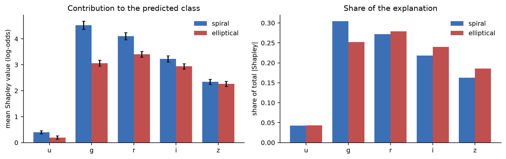
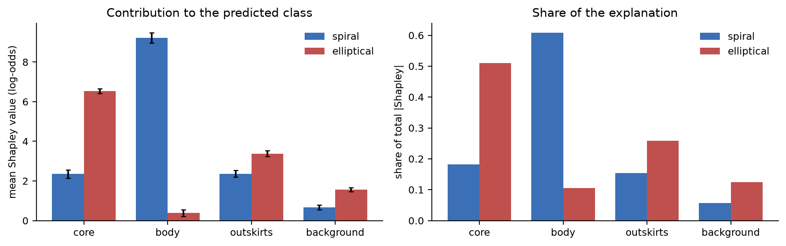
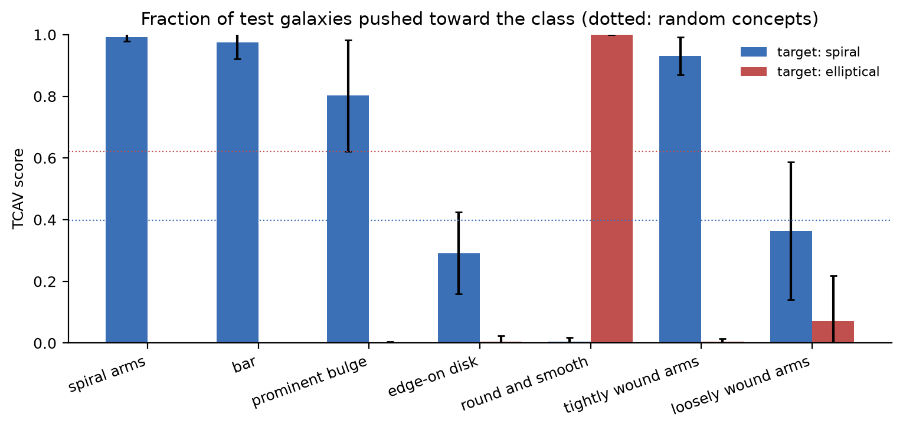
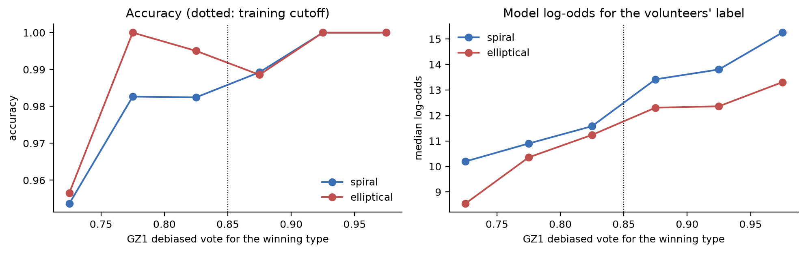
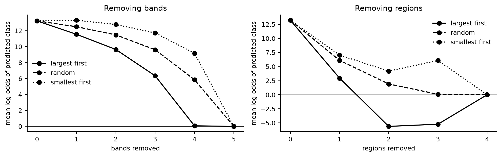

# Building an Explainable Galaxy Classifier

AIPI 590 (Explainable AI), project 2.

**Summary:** I trained a CNN to classify galaxies as spiral or elliptical from SDSS images in five separate bands (u, g, r, i, z), using Galaxy Zoo volunteer labels. I then explained it in terms astronomers already use: how much each band contributes, which parts of the galaxy (core, disk, outskirts, background) the evidence comes from, and whether the model responds to the morphology concepts volunteers look for. The CNN gets 99.7% of the test set right, against 91.9% for a classifier on SDSS catalog colors and light-profile measurements. Its evidence for "spiral" comes mostly from between R50 and R90, where most of a disk's light usually is, its evidence for "elliptical" from the core and outskirts, and its log-odds for the volunteers' label drop on galaxies volunteers found harder to call. Two checks confirm that the explanations reflect the trained model: one randomizes the model's weights, the other removes the highest-valued parts first.

The full write-up, with every figure and number, is in [`analysis.ipynb`](analysis.ipynb).

## Why this matters

Sky Surveys will image far more galaxies than volunteers could ever classify, so having an automated system to aid in the classification of the galaxies would be significantly helpful to astronomers.

Spiral and elliptical galaxies differ in structure (disks, arms, and bars against smooth, concentrated light) and in color (spiral galaxies are usually bluer because their disks are still forming young stars). Both are real physical differences, so a model using either is using real information. But they don't always go together. Some disk galaxies can be redder with large central bulges. Knowing how a classifier weighs color against structure, and whether that matches astrophysics, says how far its labels can be trusted on galaxies.

This project also follows on from project 1, which found that pixel-level saliency maps can look convincing without reflecting what a model uses. So this project explains the model in astronomical terms (bands, and regions scaled to each galaxy's size) rather than pixels. The explanations are exact Shapley values rather than gradients, they're checked against other measurements of the galaxies, and they're tested directly with model randomization and removal-order checks.

## Main results

Each number is the share of galaxies classified correctly (spiral or elliptical, compared with the Galaxy Zoo label).

| Model | Test set (879) | Galaxy Builder spiral galaxies (191) | Moderate-agreement set (991) |
|---|---|---|---|
| Catalog values: color only | 86.3% | | 76.7% |
| Catalog values: structure only | 90.6% | | 82.5% |
| Catalog values: color and structure | 91.9% | | 83.0% |
| **CNN, five bands (band dropout)** | **99.7%** | **98.4%** | **98.0%** |
| CNN, five bands (no band dropout) | 99.5% | 97.9% | 97.4% |

- **Columns:** All three sets were held out from training. The test set has the same kind of galaxies the models were trained on. The Galaxy Builder set contains only spiral galaxies, so its accuracy is the share of them called spiral. The moderate-agreement set has galaxies where only 70–85% of volunteers agreed on the winning type. The models never saw galaxies this uncertain during training.
- **Catalog rows:** These are a baseline built from values the SDSS pipeline already measures for every galaxy: two colors, and two measures of how concentrated the light is (fracDeV_r is the fraction of the r-band light fit by an elliptical-like de Vaucouleurs profile rather than an exponential disk, and R90/R50 is the ratio of the radii holding 90% and 50% of the light). They are trained on the same training galaxies as the CNN. I didn't run them on the Galaxy Builder set.
- **CNN rows:** Band dropout means that during training each band is blanked at random 15% of the time, so the model doesn't lean too heavily on any one band. The model without it is a second, otherwise identical model used to check that the explanations don't depend on one training run.

**What the CNN adds over catalog values:** It gets 69 of the 71 test galaxies the catalog model misses right. Most of those are spiral galaxies whose catalog values look elliptical-like. For them the model relies on the disk and overrides a core that points toward elliptical.

**Bands:** Most of the evidence comes from g, r, and i. The faint u band contributes about 4%. The model gets 98.9% right from the g band alone, so it can classify from structure without color. Spiral galaxies lean slightly more on g and elliptical galaxies slightly more on the redder bands.



**Regions:** Evidence for "spiral" comes mostly from between the half-light radius R50 and R90, where most of a disk's light usually is. The regions are based on how much light they enclose, so they only roughly match the disk and central bulge. Evidence for "elliptical" comes from the core and the outskirts.



**Concepts (TCAV):** Galaxy Zoo 2 concepts for spiral arms, bars, and tightly wound arms push test spiral galaxies toward "spiral". "Round and smooth" pushes elliptical galaxies toward "elliptical". Edge-on disks push spiral galaxies toward "spiral" no more than random concepts do, even though every galaxy in that concept set is a spiral galaxy, so the scores reflect more than class membership.



**Physical checks:** In spiral galaxies with bigger central bulges, the core gives less evidence for "spiral" and in 13% of them points toward "elliptical". This holds for three different measurements of the central bulge: SDSS fracDeV_r, Galaxy Zoo 2 votes, and Galaxy Builder bulge fractions.

**Less certain galaxies:** The model was trained only on galaxies where more than 85% of volunteers agreed, but its log-odds for the volunteers' label fall steadily as volunteer agreement falls. Most of its mistakes on the moderate set are red disk galaxies with large central bulges that it calls elliptical.



**Checks on the explanations:** Models with random weights give very different region explanations (median per-galaxy Spearman ρ 0.2–0.4, against 0.8 between the two trained models). Removing the regions or bands with the largest Shapley values first lowers the model's log-odds faster than a random order for 98–99% of galaxies.



## Repository layout

```
scripts/01_build_sample.py       choose galaxies, assign splits, look up SDSS frame info and catalog values
scripts/02_download_cutouts.py   download SDSS frames and make aligned 5-band cutouts
scripts/03_train.py              train the two CNNs (or re-score saved ones with --eval-only)
src/galaxy_bands/config.py       paths, sample settings, image geometry, SDSS URLs
src/galaxy_bands/data.py         loading, normalization, radial regions, augmentation, band dropout
src/galaxy_bands/model.py        the CNN
src/galaxy_bands/train.py        training loop, prediction, metrics
src/galaxy_bands/experiments.py  Shapley values, KernelSHAP, TCAV, catalog baseline, explanation checks
analysis.ipynb                   every experiment and the full write-up
data/                            sample table, cutout coverage, Galaxy Builder catalog
models/                          trained checkpoints
results/                         cached experiment outputs
figures/                         figures saved by the notebook
```

## Reproducing the results

Requires Python 3.12. Package versions are pinned in `requirements.txt`.

```bash
python -m venv .venv
source .venv/bin/activate
pip install -r requirements.txt
```

### Option 1: rerun the analysis from the included results

The trained models and every experiment's output are in the repo, so the notebook can be opened and read without running anything. To rerun it, the cutouts are still needed (step 2 below), because the notebook loads the images. Cached results in `results/` are reused, so a rerun takes a few minutes.

### Option 2: rebuild everything from the raw data

1. Download the two large Galaxy Zoo tables from the [Galaxy Zoo data page](https://data.galaxyzoo.org/) into `data/raw/`:
   - Galaxy Zoo 1, Table 2, saved as `GalaxyZoo1_DR_table2.csv`
   - Galaxy Zoo 2, Hart et al. (2016) table, saved as `gz2_hart16.csv.gz`

   The Galaxy Builder catalog is already in `data/raw/`.
2. Run the pipeline:

```bash
python scripts/01_build_sample.py
python scripts/02_download_cutouts.py --workers 16
python scripts/03_train.py
jupyter nbconvert --to notebook --execute --inplace analysis.ipynb
```

To redo an experiment from scratch, delete its file in `results/` before running the notebook (see Troubleshooting).

| Step | What it does | Time (M-series Mac, home internet) | Disk |
|---|---|---|---|
| 01 build sample | Queries the SDSS database for 7,156 galaxies | a few minutes | 2 MB |
| 02 download cutouts | Downloads about 35,000 SDSS frames (7,000 fields × 5 bands) and saves one cutout per galaxy | a little over 3 hours | 2.2 GB |
| 03 train | Trains both CNNs (up to 150 epochs, about 15 s each) | about 1 hour | 9 MB |
| notebook | Runs every experiment, caching results | a few minutes with cached results; longer from scratch, mostly KernelSHAP and TCAV | 2.2 GB image cache, a few MB of results |

Step 1 and step 2 can be stopped and rerun: step 1 keeps galaxies already in `data/sample.csv`, and step 2 skips galaxies that already have a cutout. `python scripts/03_train.py --eval-only` re-scores the saved models without retraining.

### Expected results

A full rerun should reproduce these numbers to within small differences. Results can differ slightly between Apple MPS, CUDA, and CPU, because their random number streams and floating-point details differ.

| Quantity | Expected |
|---|---|
| Test accuracy, band dropout model | 99.7% (3 errors in 879) |
| Galaxy Builder galaxies called spiral | 98.4% |
| Moderate-agreement accuracy | 98.0% |
| Catalog baseline (color and structure), test | 91.9% |
| g band alone, test | 98.9% |
| u band share of band Shapley values | about 4% |

## Outputs

### Models

| File | Contents |
|---|---|
| `models/band_dropout.pt` | Main model, trained with band dropout (p = 0.15). The checkpoint stores `state_dict`, `hparams`, `mode`, and `epochs_run`; load with `galaxy_bands.model.load`. |
| `models/plain.pt` | Same architecture, trained without band dropout. Used as a robustness check. |

### Data

| File | Contents |
|---|---|
| `data/sample.csv` | One row per galaxy: ID, position, label, split (`train`, `val`, `test`, `galaxy_builder`, `moderate`), GZ1 vote fractions, SDSS frame identifiers, Petrosian radii, extinction-corrected magnitudes, fracDeV_r, redshift, the cutout pixel scale, and the GZ2 vote fractions used for the concepts. |
| `data/cutout_status.csv` | Fraction of each cutout covered by SDSS data in each band. Galaxies below 99% in any band are dropped. |
| `data/cutouts/<OBJID>.npy` (not in git) | Raw 5 × 128 × 128 cutout in nanomaggies, north up. |

### Results

All of these are written by `scripts/03_train.py` or `analysis.ipynb` (the notebook section is given). The Shapley tables have one row per galaxy with `OBJID`, `label`, and `pred` (the class being explained). They include a `phi_<player>` column per band or region, `v_all` and `v_none` (log-odds with everything present and with nothing), and a `v_<bits>` column with the log-odds for every combination of players present (1) or removed (0), in the same order as the `phi_` columns.

| File | Produced by | Contents |
|---|---|---|
| `test_metrics.csv` | `03_train.py` | Accuracy, AUC, and log loss for each model on the test, Galaxy Builder, and moderate sets |
| `history_band_dropout.csv`, `history_plain.csv` | `03_train.py` | Per-epoch learning rate, training and validation loss and accuracy, and time |
| `band_noise.json` | first data load | Background noise per band (nanomaggies per pixel), used for the arcsinh stretch |
| `band_ablation.csv` | Training section | Test accuracy with all bands, each band alone, and each band left out |
| `band_shapley_test.csv` | Section 1 | Exact band Shapley values, test set |
| `region_shapley_test.csv` | Sections 2 and 4 | Exact region Shapley values, test set (region 0 core, 1 body, 2 outskirts, 3 background) |
| `band_region_shap_test.csv` | Section 2 | KernelSHAP values for the 20 band × region groups, 200 test galaxies |
| `tcav_runs.csv` | Section 3 | TCAV score for every concept, run, and target class, including random concepts |
| `region_shapley_galaxy_builder.csv` | Section 4 | Region Shapley values for Galaxy Builder galaxies |
| `band_shapley_test_plain.csv`, `region_shapley_test_plain.csv` | Sections 5 and 7 | Band and region Shapley values for the model without band dropout |
| `band_shapley_moderate.csv`, `region_shapley_moderate.csv` | Section 6 | Band and region Shapley values for the moderate-agreement set |
| `band_shapley_test_random{0,1,2}.csv`, `region_shapley_test_random{0,1,2}.csv` | Section 7 | Shapley values from three randomly initialized copies of the main model, explaining the trained model's predicted class |

### Figures

| File | Notebook section |
|---|---|
| `five_band_examples.png` | Data: two spiral and two elliptical galaxies in each band |
| `color_redshift.png` | Data: u − r color and redshift by class |
| `learning_curves.png` | Training |
| `band_shapley.png`, `blue_share_vs_color.png` | 1. Bands |
| `region_shapley.png`, `band_region_shap.png` | 2. Regions |
| `tcav.png` | 3. Concepts |
| `physical_checks.png` | 4. Physical checks |
| `agreement.png` | 6. Less certain galaxies |
| `deletion.png` | 7. Checks on the explanations |

## Design decisions

**Labels:** Galaxies are from Galaxy Zoo 1 with at least 30 votes and a debiased vote fraction above 0.85 for spiral or elliptical, the same threshold as project 1. I used the debiased fractions rather than the SPIRAL/ELLIPTICAL flags, because the Galaxy Zoo data page notes the flags come from a different correction. Only galaxies also in Galaxy Zoo 2 are kept, so each one has detailed morphology votes. In GZ1, "spiral" includes edge-on disks.

**Sample:** 3,000 galaxies per class, split 70/15/15 into train, validation, and test with a fixed seed. The Galaxy Builder galaxies are kept out of training as a separate check. 99 galaxies whose cutouts ran off the edge of an SDSS frame were dropped, leaving 6,061, including 191 from Galaxy Builder.

**Moderate-agreement test set:** A further test set has 500 galaxies of each type where 70–85% of the debiased GZ1 vote went to the winning type (30+ votes, in GZ2). The winning type is the label, and 991 are left after the same edge-of-frame cut. They are only used for evaluation. The models were not retrained after they were added, and adding them didn't change the other splits.

**Images:** I used the calibrated SDSS DR17 frames instead of the color JPEGs used in ASTRO 416 and project 1, so each band could be a separate channel in physical units. GZ1 and GZ2 use DR7 object IDs, which aren't in DR17, so galaxies are matched by position (nearest object within 3″). Each band is resampled onto the same 128×128 grid, 4 × R90 across, which lines up the bands and scales every galaxy to its own size. Each band is then stretched with arcsinh(flux / background noise). The noise is measured separately for each band from the corners of the training cutouts.

**Model:** The CNN from project 1 with five input channels, using the hyperparameters tuned in project 1. The main model uses band dropout (each band zeroed with probability 0.15 in training, keeping at least one). The explanations remove bands by zeroing them, so the model has seen that kind of input before. A second model trained without band dropout is used to check how much the conclusions depend on that choice.

**Catalog baseline:** Logistic regression on two colors (u − r, g − r) and two light-profile measurements (fracDeV_r and the concentration R90/R50), trained on the same training galaxies. It shows how far standard catalog values get without the images, so the explanations can show what the CNN adds.

**Explanations:** Everything explains the log-odds of the predicted class, because log-odds add up across features and probabilities near 0 or 1 don't. Removing a band or region means setting it to zero, which after sky subtraction means no light. With 5 bands or 4 regions there are only 32 or 16 combinations, so the Shapley values are exact. The 20 band × region groups use KernelSHAP instead. The TCAV concepts require the earlier answers in the GZ2 decision tree, since questions about bars, central bulges, and arms are only asked of galaxies that volunteers said have a disk.

**Checks on the explanations:** Two checks follow up on project 1, which found that explanations can look reasonable without reflecting the model. In the first, the Shapley values are recomputed with randomly initialized copies of the model, explaining the same class. In the second, the bands or regions are removed one at a time in order of their Shapley values, compared with random and reverse orders.

## Troubleshooting

- **A notebook result didn't change after editing the code:** The notebook reuses any result already saved in `results/` with the same file name. Delete the relevant CSV (listed under Outputs) and rerun. If the training split changes, also delete `results/band_noise.json`. The image cache `data/cubes.npy` rebuilds itself when the sample changes.
- **Step 1 fails with an SDSS query error:** The SDSS SkyServer sometimes times out. Each query is retried five times. If it still fails, rerun the script. Once `data/sample.csv` exists, a rerun only looks up galaxies that aren't in it yet.
- **Step 2 reports failed fields:** Rerun it. Galaxies that already have a cutout are skipped, so only the failures are retried.
- **SSL certificate errors** (for example on a university or company network). The code uses `truststore` so Python trusts the operating system's certificates. Make sure it is installed.
- **Running out of memory:** The data loader keeps every cutout in memory, and while loading it briefly holds both the raw and normalized images (about 5 GB for 7,000 galaxies). A machine with 16 GB of RAM is comfortable.
- **No GPU:** The code uses Apple MPS or CUDA when available and falls back to the CPU. Training on a CPU works but is much slower.

## Limitations

The model is trained only on confident Galaxy Zoo classifications. The extra test set reaches down to 70% agreement, but the most ambiguous galaxies are still left out. Removing a region creates images unlike real galaxies, and the uneven removal curves show the model reacting to that. The regions are circles, even though inclined disks look elliptical on the sky. Most TCAV concept sets are mostly one class. Each model was trained once, and the two models split the credit among g, r, and i differently. More detail is in the notebook.

## Data

Images are from the Sloan Digital Sky Survey (SDSS) DR17. Labels are from Galaxy Zoo 1 (Lintott et al. 2008, 2011), Galaxy Zoo 2 (Willett et al. 2013, with the debiased table from Hart et al. 2016) and Galaxy Builder (Lingard et al. 2020), as the [Galaxy Zoo data page](https://data.galaxyzoo.org/) asks.
